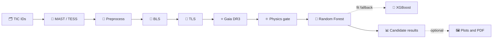

<div align="center">

# 🪐 TESS Transit Detection Pipeline

### Find transit-like signals in NASA TESS light curves

**Physics-led detection · Gaia stellar context · ML-assisted candidate classification**


</div>

---

## 📋 Table of Contents

- [🚀 How It Works](#-how-it-works)
- [🏗️ Pipeline Stages](#️-pipeline-stages)
- [⚛️ Physics Checks](#️-physics-checks)
- [📈 Validation Snapshot](#-validation-snapshot)
- [⚡ Quick Start](#-quick-start)
- [📁 Project Structure](#-project-structure)
- [⚙️ Configuration](#️-configuration)
- [📊 Output Files](#-output-files)
- [🧰 Requirements](#-requirements)

---

## 🚀 How It Works

Give the pipeline a CSV of TIC IDs. It retrieves TESS light curves from the [MAST archive](https://archive.stsci.edu/), searches for repeating transit-like dips, adds [Gaia DR3](https://www.cosmos.esa.int/web/gaia/dr3) stellar information when available, and evaluates each extracted candidate using the physics evidence present in the data.

The patched pipeline is **physics-led**: a signal must first pass the transit detection gate. Random Forest then helps classify a physically admitted candidate; XGBoost is available as a fit-error fallback. A model score or catalogue match cannot turn a signal that failed the physics gate into a `TRANSIT`.

> [!IMPORTANT]
> `TRANSIT` means **transit candidate**. It does not mean the planet is confirmed. Confirmation requires authoritative catalogue evidence or follow-up observations.

### 🎯 Patched transit gate

- Harmonic check must pass.
- TLS SDE must be **≥ 3.0**.
- If TLS cannot return an SDE, the fallback is BLS SDE **≥ 10.0**.
- A measured physics composite **≥ 0.70** can support `TRANSIT` without ML.
- Otherwise, ML score **≥ 0.60** may support classification only after the physics gate passes.

The displayed confidence score continues to combine **60% physics and 40% ML**. The gate determines whether ML can participate in a transit decision; the weighted score expresses candidate confidence.

---

## 🏗️ Pipeline Stages

| Stage | Name | What happens |
|---:|---|---|
| 1 | 📥 Preprocess | Retrieve, clean, and detrend TESS photometry. |
| 2 | 🔎 Transit search | Screen with BLS and refine detected periods with TLS. |
| 3 | ⭐ Stellar context | Cross-match with Gaia DR3 for available stellar parameters. |
| 4 | ⚛️ Physics checks | Calculate measurable transit and false-positive diagnostics. |
| 5 | 🤖 Classification | Use Random Forest to classify candidates; XGBoost can rescue model fitting failures. |
| 6 | 📐 Parameters | Estimate candidate parameters and uncertainties. |
| 7 | 🎯 Scoring | Apply the physics gate and compute candidate confidence. |
| 8 | 📊 Visualization | Generate diagnostic plots and a PDF report when requested. |



---

## ⚛️ Physics Checks

These checks use the available TESS light curve and Gaia context. They are evidence for candidate screening; they do not reproduce Hubble or JWST observations.

| Diagnostic | What it checks | Status in patched pipeline |
|---|---|---|
| Depth vs. Gaia radius 🔭 | Whether the measured depth is broadly consistent with the available stellar radius | Scored when valid Gaia radius is available |
| Ingress/egress shape 📈 | Transit shape clues, including V-shaped or grazing events | Scored when the light curve supports it |
| Secondary eclipse 🌑 | Additional dimming near the expected secondary phase | Scored when coverage supports it |
| Odd/even depths 🔁 | Alternating transit depths that may indicate an eclipsing binary | Scored when enough events are available |
| Ellipsoidal variation ✨ | Orbital brightness modulation associated with close companions | Scored when measurable |
| Achromaticity 🌈 | Wavelength-dependent transit depth | Unavailable with this single-band TESS input |
| Atmosphere 🌫️ | Spectroscopic atmosphere evidence | Unavailable without spectroscopy |
| Centroid motion 🎯 | Transit-correlated source-position shift | Not measured in this patched run |

Unavailable checks are displayed as **N/A**, carry an explanatory status in the feature output, and are left out of the physics composite. The pipeline does not replace missing measurements with guessed scores.

---

## 📈 Validation Snapshot

The latest reviewed catalogue comparison covered 27 TIC IDs. Eighteen had decisive source labels: 13 confirmed transiting planets and five EB-only catalogue targets. Two of those TIC IDs also occur in training labels/features.

| Metric | Result |
|---|---:|
| Transit vs. non-transit accuracy, all 18 labeled targets | **17/18 · 94.4%** |
| Transit vs. non-transit accuracy, excluding the two overlapping TICs | **15/16 · 93.8%** |
| Confirmed planets called `TRANSIT` in overlap-excluded subset | **10/11 · 90.9%** |
| EB-only targets not called `TRANSIT` | **5/5 · 100%** |
| Exact 3-class accuracy, overlap-excluded subset | **13/16 · 81.3%** |
| EB subtype classification | **3/5 · 60.0%** |

The comparison batch and labels were reviewed while refining thresholds, so these results are **not an independent benchmark**. Nine targets without decisive labels were excluded. One confirmed planet was not extracted as a candidate, and one selected period did not match its catalogue period.

📄 [Open the detailed validation report](outputs/physics_na_fix_test_no_planets/accuracy_report.md) · 🧾 [Inspect per-TIC labels and predictions](outputs/physics_na_fix_test_no_planets/catalog_accuracy_crosscheck.csv)

---

## ⚡ Quick Start

### 1. Install dependencies

```powershell
pip install -r requirements.txt
```

### 2. Prepare a TIC ID CSV

The input file needs a `tic_id` column:

```csv
tic_id
138361973
349518145
```

### 3. Run the patched pipeline

```powershell
python run_pipeline_patched.py --tic-ids data/master_test.csv
```

The patched runner skips Stage 8 visualization by default. To request plots and the PDF report:

```powershell
python run_pipeline_patched.py --tic-ids data/master_test.csv --stages 1,2,3,4,5,6,7,8
```

See all supported options:

```powershell
python run_pipeline_patched.py --help
```

⏳ Runtime depends on MAST availability, TESS sector coverage, and the number of TIC IDs. Inputs with no extracted BLS/TLS candidate will not have a candidate classification row.

---

## 📁 Project Structure

```text
config/                  ⚙️ Pipeline configuration
data/                    🗂️ TIC lists and curated labels
patches/                 🩹 Patched pipeline behavior
tess_pipeline/           🔭 Processing, detection, physics, ML, and output stages
run_pipeline.py          ▶️ Base pipeline runner
run_pipeline_patched.py  🚀 Patched pipeline runner
outputs/                 📦 Run artifacts and validation reports
```

---

## ⚙️ Configuration

Main defaults are in [`config/default.yaml`](config/default.yaml). The patched run used BLS SDE **4.0** for the primary search; the physics gate applies TLS SDE **3.0** and the high-SDE BLS fallback described above. CLI options can override runtime settings; use `--help` to see available options.

The confidence weighting is configured as **60% physics / 40% ML**. The patched transit gate still applies before ML can support a transit classification.

---

## 📊 Output Files

| Output | Contents |
|---|---|
| `outputs/results/candidate_predictions.csv` | Candidate class, confidence, physics gate result, and supporting evidence |
| `outputs/results/candidate_parameters.csv` | Fitted transit parameters and uncertainty estimates |
| `data/processed/features.csv` | Measured features and availability statuses |
| `outputs/plots/` | Candidate diagnostics when Stage 8 is requested |
| `outputs/reports/` | PDF report when Stage 8 is requested |

Actual paths follow the configured output directories and run settings.

---

## 🧰 Requirements

- Python 3.8+
- NumPy, SciPy, pandas, scikit-learn, XGBoost
- Astropy, Lightkurve, Astroquery, Transit Least Squares
- Matplotlib, Joblib, PyYAML, tqdm, ReportLab

Install the pinned dependency ranges from [`requirements.txt`](requirements.txt). The pipeline is designed to run on CPU; no GPU is required.

---

<div align="center">

🔭 **Search the signal · test the physics · review the candidate**

</div>
